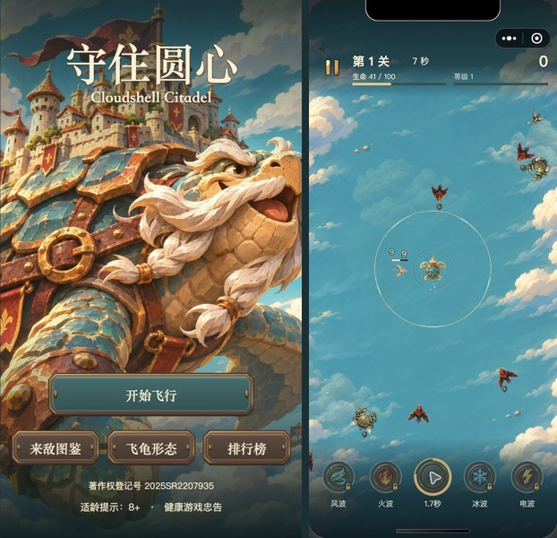

# 守住圆心 · Cloudshell Citadel

一只驮着城堡的飞龟穿过云海。怪物从四面飞向龟背，点按普通、风、火、冰、电五个冲击波抵御来敌。首页展示云背王城的最终形态。每局从幼龟起航，在关末解锁不同元素，龟背会长出对应的设施。

## 开始游戏

- **微信开发者工具**：选择小游戏，导入本仓库根目录，使用普通编译。开发客户端无需安装依赖。工程配置使用开发测试 AppID，其他开发者可在导入时选用自己的测试号或小游戏 AppID。
- **浏览器本地试玩**：使用 Node.js 18 或更新版本，在仓库根目录运行 `node scripts/preview.js`，打开 [本机游戏](http://127.0.0.1:18421/)。两种入口运行同一份 `minigame/game.js`。浏览器使用独立本机存档；微信关系链、云排行与激励视频需在微信端验证。
- **战斗操作**。点击开始并阅读健康提示。等待敌人进入射程，点按底部中央的普通波。左上角可暂停。
- **关末奖励**。倒计时结束后先显示通关结果。每个强化点都要从三张卡里选一张。进入元素工坊后，若有买得起的项目，须完成一次属性升级、元素解锁或觉醒，才能开始下一关。剩余升级点可留给后续关卡。所有项目已满或点数不足时，可直接继续。[战斗数值与模拟记录](docs/balance.md)

## 飞龟与来敌

风、火、冰、电四系形成 16 种组合，随本局实际解锁改变外形。首页的形态图册可查看装备、剪影与达成情况。10 种敌人在首次实际生成时点亮图鉴，收藏记录保存在本机。第 1 关有 7 种可以遇见，第 4、6、10 关分别将精英、幽灵和首领加入生成池。个体实际抗性与免疫以本次生成结果为准。

美术索引位于 `minigame/common/art/`。主包携带首页、天空、初始龟、基础敌兵和普通波，五个资源分包按画面需求加载。图片完成解码后自动重绘，动画只读取帧表声明的有效格。画面按统一的 375 × 667 战场投影，四边出怪、圆形碰撞及原有固定步长模拟均使用逻辑坐标。

## 平台功能和配置

| 功能 | 代码和配置 | 玩家看到的结果 |
| --- | --- | --- |
| 本机记录 | 微信同步存储，键为 `waveGameHighScore` | 每次超过旧纪录即保存，退出和重开后仍可在「排行榜 → 本机」查看 |
| 好友榜 | 好友互动授权、微信开放数据域和共享画布 | 展示同玩好友最高分前十。拒绝授权可从「去设置」返回；读取失败可刷新。好友榜使用微信关系链服务，无需 CloudBase 或自有服务器域名 |
| 总榜 | `minigame/settings.js` 的 `cloudEnvId`、`leaderboard` 云函数及 PostgreSQL | 按服务端核算的最高成绩展示匿名前十，同分按玩家序号排列。环境留空时显示“总榜尚未开放” |
| 激励视频复活 | 同一配置文件的 `rewardedVideoAdUnitId` | 广告位留空时结算提供重新挑战和榜单。配置后，玩家可主动选择完整观看、满血复活，每局限一次。提前关闭、展示失败或加载超时可重新挑战 |

**好友成绩。** 开放数据域把每个安装实例的最高分保存到两个设备槽，展示时取各槽和旧键 `circle_best_v1` 的最大值。两台设备写入不同槽位时各自保留纪录。微信托管键值接口采用普通覆写，同一账号的两个安装实例恰好同时选中同一对槽、又并发写入，仍存在覆盖窗口。玩家打开好友榜时会用本机最高分重新同步；同步失败会在榜内提示。好友昵称始终在开放数据域内读取和绘制。[微信关系链数据](https://developers.weixin.qq.com/minigame/dev/guide/open-ability/open-data.html) · [好友互动授权](https://developers.weixin.qq.com/minigame/dev/api/open-api/data/wx.getFriendCloudStorage.html)

**总榜计分。** 配置云环境后，每局开始请求云端签发的出怪序列。当前微信包请求第 2 版刷怪规则，云函数按开局保存的版本验分；旧客户端和此前签发的对局继续使用第 1 版。两版沿用同一套敌人分值与最高分记录。服务端从微信上下文绑定 AppID、OpenID 和对局编号，按关卡、出生序号和服务器时钟检查记录，拒绝重复序号和超出生成进度的记录，按签发敌人的分值重算并原子更新最高分。开局联网失败、云函数尚未支持当前规则或未及时取得序列时，本局继续计入本机和好友成绩。已取得凭据的成绩暂存本机，网络恢复后可在总榜刷新补传，对局有效期为 24 小时。旧版本保存的本机高分继续展示在本机和好友榜。此总榜核验出怪进度与计分，击杀事件由客户端报告，仍无法独立证明每一次命中和击杀。

**复活。** 广告按次创建实例并在结束时释放。只有微信明确回报完整观看才发放复活，同一局保留得分，场上敌人和光波清除；提前关闭和广告错误仍可继续操作。真实填充和收入以本游戏流量主后台为准。[微信激励视频](https://developers.weixin.qq.com/minigame/dev/guide/open-ability/ad/rewarded-video-ad.html)

### 启用总榜所需配置

仅在决定启用全服总榜时办理。腾讯云官方快速开始说明，新建环境当前使用 PostgreSQL；此实现使用 PG 表、索引和云函数。登录云开发时选择目标微信公众平台账号，确认关联 AppID、环境 ID、区域、套餐价格和配额。[CloudBase 快速开始](https://cloud.tencent.com/document/product/876/121103) · [微信端 SDK](https://cloud.tencent.com/document/product/876/19385)

1. 在该环境的 PG SQL 编辑器执行 [建表脚本](database/leaderboard.sql)。它创建私有 schema、对局凭据表、成绩表及索引，也可对旧表重复运行。旧版总分保留在原列，公开榜从新版对局重算列取值。保持 `circle_game` 在客户端 API 对外暴露的 schema 之外。
2. 为云函数准备可访问该库的服务端 PG 连接串，按实例配置网络连通与 TLS。数据库角色需要 schema 的 USAGE、成绩表的 SELECT / INSERT / UPDATE、对局表的 SELECT / INSERT / DELETE 和标识序列的使用权限。仅在云函数环境变量中填写 `DATABASE_URL`。使用正式环境前核对数据库连接限制与云函数并发数。[CloudBase 数据库与网络安全](https://docs.cloudbase.net/faq/security/classified-protection)
3. 在开发者工具选择关联环境，部署 `cloudfunctions/leaderboard`，函数名为 `leaderboard`，Node.js 18 或以上运行时、入口 `index.main`，云端安装目录中声明的 npm 依赖。小游戏通过 `wx.cloud.callFunction` 调用，不需创建公开 HTTP 触发器。将环境 ID 填入 [微信功能配置](minigame/settings.js)。
4. 用两个体验账号分别打分，在不同关卡退出或复活，核对击杀成绩、同局补传、同分排序和同一用户只占一行。

## 验证

运行 `node --test tests/*.test.js` 检查战斗、升级、收藏、资源分包、广告回调和排行榜逻辑。数值模拟的运行命令见[模拟说明](docs/balance.md)。发布前以正式 AppID 和真实设备核对微信关系链、广告填充和云端成绩。
